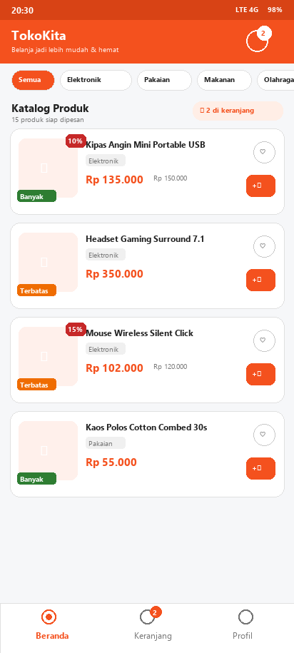
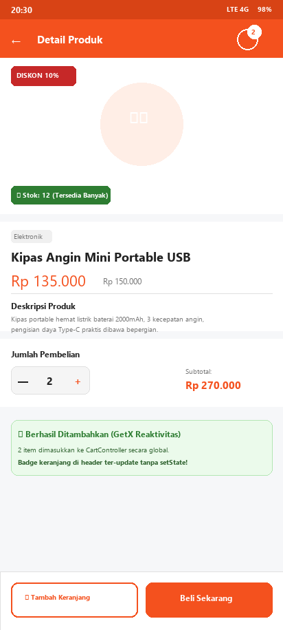
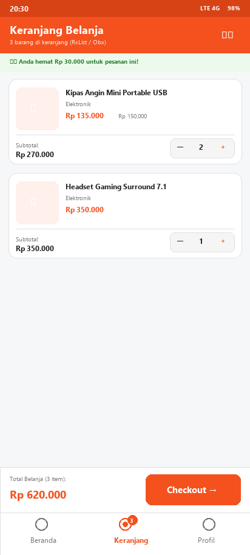
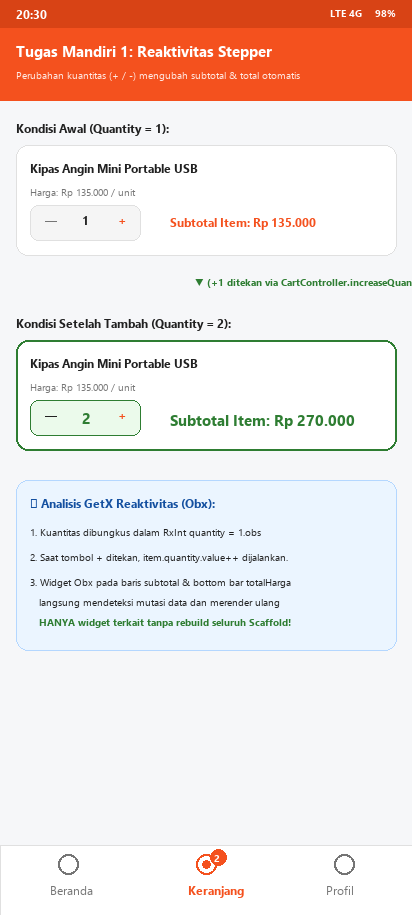
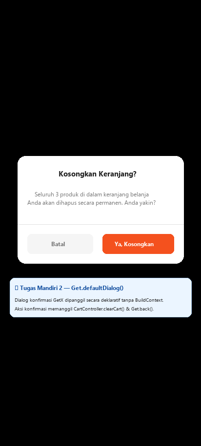
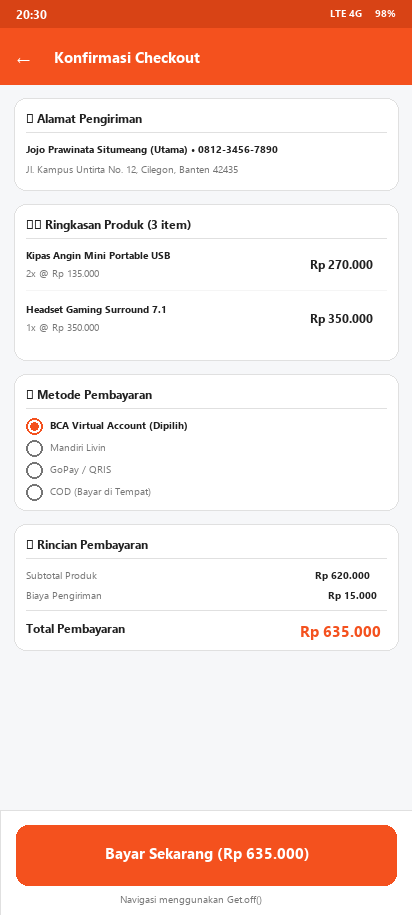
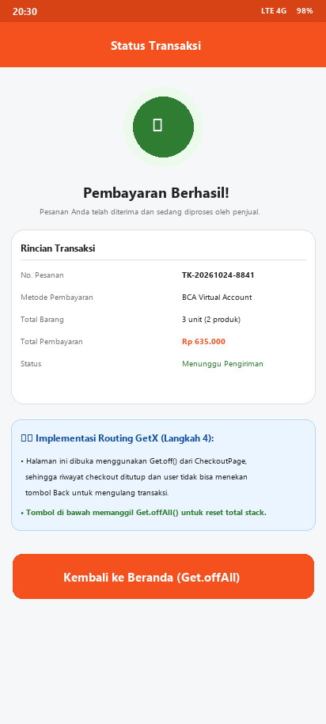

# TokoKita — Tugas Pertemuan 6: State Management dengan GetX

> **Mata Kuliah:** Pemrograman Sistem Mobile (3 SKS)  
> **Pertemuan:** Pertemuan 6 — Mode Luring (Kelas + Lab)  
> **Topik:** State Management dengan GetX  
> **Studi Kasus:** Project TokoKita — Mengelola State Keranjang Belanja Terpusat dengan GetX  
> **Nama Mahasiswa:** Jojo Prawinata Situmeang  
> **NIM:** 3337240060  
> **Program Studi:** Teknik Informatika  

---

## 📌 Daftar Isi
1. [Deskripsi Proyek](#-deskripsi-proyek)
2. [Tiga Pilar Utama GetX](#-tiga-pilar-utama-getx)
3. [Struktur Folder & Arsitektur Kode](#-struktur-folder--arsitektur-kode)
4. [Rincian Implementasi Langkah Kerja (1–5)](#-rincian-implementasi-langkah-kerja-15)
5. [Rincian Implementasi Tugas Mandiri](#-rincian-implementasi-tugas-mandiri)
6. [Tabel Perbandingan: setState vs GetX](#-tabel-perbandingan-setstate-vs-getx)
7. [Analisis Konseptual Penggunaan State Management](#-analisis-konseptual-penggunaan-state-management)
8. [Galeri Screenshot Aplikasi](#-galeri-screenshot-aplikasi)
9. [Pengujian Otomatis (Unit & Widget Test)](#-pengujian-otomatis-unit--widget-test)
10. [Cara Menjalankan Proyek](#-cara-menjalankan-proyek)

---

## 📖 Deskripsi Proyek

Pada Pertemuan 5 sebelumnya, data keranjang TokoKita masih dikirim antar halaman secara manual menggunakan parameter rute `Navigator` dan belum tersimpan secara terpusat. Akibatnya, jumlah item di keranjang akan hilang begitu berpindah tab, karena setiap halaman mengelola state-nya secara terisolasi.

Pada **Pertemuan 6** ini, aplikasi **TokoKita** dievolusikan menggunakan pustaka **GetX** untuk menerapkan **State Management**, **Route Management**, dan **Dependency Injection** yang terpusat. State keranjang belanja dikelola oleh `CartController`, sehingga data keranjang (jumlah item, harga subtotal, penghematan diskon) selalu konsisten dan sinkron secara instan di seluruh layar (Beranda, Detail Produk, Keranjang, Checkout, dan Profil) tanpa pemanggilan `setState` manual di widget induk.

---

## 🚀 Tiga Pilar Utama GetX

GetX menyediakan tiga pilar pengembangan aplikasi mobile Flutter dalam satu paket ringan tanpa boilerplate berlebih:

```
                  ┌─────────────────────────────────────────┐
                  │               GETX FRAMEWORK            │
                  └────────────────────┬────────────────────┘
          ┌────────────────────────────┼────────────────────────────┐
          ▼                            ▼                            ▼
┌──────────────────┐         ┌──────────────────┐         ┌──────────────────┐
│ State Management │         │ Route Management │         │    Dependency    │
│                  │         │                  │         │    Management    │
├──────────────────┤         ├──────────────────┤         ├──────────────────┤
│ • GetxController │         │ • Get.to()       │         │ • Get.put()      │
│ • RxList / .obs  │         │ • Get.back()     │         │ • Get.find()     │
│ • Widget Obx()   │         │ • Get.off()      │         │ • Bindings       │
│ • Granular build │         │ • Get.offAll()   │         │ • Memory cleanup │
└──────────────────┘         └──────────────────┘         └──────────────────┘
```

1. **State Management**:
   - Logika bisnis dipisahkan ke dalam class `CartController` yang extends `GetxController`.
   - Data reaktif dideklarasikan menggunakan tipe Rx (seperti `RxList<CartItem>` atau `.obs`).
   - Widget tampilan dibungkus dengan `Obx(() => ...)`, yang hanya membangun ulang (*rebuild*) bagian widget yang membaca variabel reaktif tersebut saat nilainya bermutasi.
2. **Route Management**:
   - Navigasi layar dilakukan tanpa membutuhkan `BuildContext`.
   - Mendukung `Get.to()` (setara `push`), `Get.back()` (setara `pop`), `Get.off()` (setara `pushReplacement`), dan `Get.offAll()` (setara `pushAndRemoveUntil`).
3. **Dependency Management**:
   - Menggunakan `Get.put(CartController(), permanent: true)` untuk mendaftarkan instance controller ke dalam memori aplikasi.
   - Mengambil instance controller dari mana saja dalam aplikasi menggunakan `Get.find<CartController>()`.

---

## 📂 Struktur Folder & Arsitektur Kode

Kode disusun mengikuti arsitektur bersih (*clean architecture*) dengan pemisahan tanggung jawab yang tegas:

```
Tugas-6/
├── lib/
│   ├── controllers/
│   │   ├── cart_controller.dart        # Logika mutasi keranjang, getter reaktif & dialog
│   │   └── navigation_controller.dart  # Kontrol tab aktif BottomNavigationBar
│   ├── models/
│   │   ├── product.dart                # Model Product, DiscountedProduct & 15 data dummy
│   │   └── cart_item.dart              # Model CartItem dengan RxInt quantity & kalkulasi
│   ├── routes/
│   │   └── go_router_example.dart      # Catatan studi komparasi Navigator 1.0 vs go_router vs GetX
│   ├── screens/
│   │   ├── main_page.dart              # Root layout dengan BottomNav, Get.put & Obx badge
│   │   ├── home_page.dart              # Katalog produk, filter kategori & reactive header badge
│   │   ├── product_detail_page.dart    # Detail produk, stepper jumlah & tombol Add to Cart
│   │   ├── cart_page.dart              # Daftar keranjang belanja nyata, stepper item, clear cart
│   │   ├── checkout_page.dart          # Rekapitulasi pesanan, alamat, pembayaran & Get.off()
│   │   ├── order_success_page.dart     # Bukti transaksi sukses & reset stack via Get.offAll()
│   │   └── profile_page.dart           # Profil mahasiswa & pembacaan state CartController
│   ├── widgets/
│   │   ├── category_tag.dart           # Chip visual kategori
│   │   ├── price_label.dart            # Format teks harga mata uang Rupiah
│   │   └── product_card.dart           # Kartu katalog produk dengan Get.to() & local setState favorit
│   └── main.dart                       # Root GetMaterialApp & GlobalBindings
├── test/
│   ├── cart_controller_test.dart       # Unit test komprehensif logika CartController
│   └── widget_test.dart                # Widget test siklus penuh GetX & navigasi
├── screenshots/                        # Bukti screenshot visual tampilan aplikasi
└── pubspec.yaml                        # Dependensi proyek (Flutter SDK & GetX 4.7.3)
```

---

## 🛠️ Rincian Implementasi Langkah Kerja (1–5)

### Langkah 1 — Instalasi & Konfigurasi GetX
- Menambahkan dependensi `get: ^4.7.2` (ter-resolve ke `4.7.3`) pada `pubspec.yaml` dan menjalankan `flutter pub get`.
- Mengganti root widget pada `lib/main.dart` dari `MaterialApp` menjadi `GetMaterialApp`.
- Mendaftarkan `GlobalBindings` untuk inisialisasi controller sebelum widget tree dirender.

### Langkah 2 — CartController & Variabel Reaktif
- Membuat class `CartController extends GetxController` di `lib/controllers/cart_controller.dart`.
- Menggunakan variabel reaktif `final RxList<CartItem> items = <CartItem>[].obs;`.
- Mengimplementasikan method:
  - `addToCart(Product product, {int quantity = 1})`: Menambahkan item baru atau meningkatkan kuantitas bila produk sudah ada dengan validasi stok.
  - `removeFromCart(Product product)`: Menghapus produk dari keranjang belanja.
- Membuat getter reaktif (computed properties):
  - `int get totalItem`: Menjumlahkan kuantitas seluruh produk.
  - `double get totalHarga`: Menghitung total nominal belanja setelah potongan diskon.
  - `double get totalHemat`: Menghitung nominal diskon yang dihemat pembeli.
- Mendaftarkan controller pada aplikasi via `Get.put(CartController(), permanent: true)` di `MainPage` dan `main.dart`.

### Langkah 3 — Obx & Reaktivitas Tampilan
- Mengambil instance controller menggunakan `final CartController cartController = Get.find<CartController>();` di `HomePage`, `ProductDetailPage`, `CartPage`, dan `ProfilePage`.
- Membungkus ikon keranjang pada Header AppBar `HomePage` dan `ProductDetailPage` serta item `BottomNavigationBar` dengan widget `Obx(() => Badge(...))` agar angka badge ter-update seketika.
- Menghubungkan tombol *"Tambah ke Keranjang"* pada `ProductDetailPage` dengan `cartController.addToCart(product, quantity: _quantity)`. Saat ditekan, badge keranjang di header langsung bertambah tanpa perlu pemanggilan `setState()` pada halaman induk.

### Langkah 4 — Routing dengan GetX
- Mengganti navigasi dari `HomePage` / `ProductCard` ke `ProductDetailPage` menggunakan `Get.to(() => ProductDetailPage(product: product))`.
- Menggunakan `Get.back()` pada tombol panah kembali di `ProductDetailPage` dan `CheckoutPage`.
- Menerapkan `Get.off(() => OrderSuccessPage(...))` pada halaman checkout setelah pembayaran berhasil, sehingga riwayat form checkout digantikan sepenuhnya dan tidak dapat dibuka kembali via tombol Back.
- Menerapkan `Get.offAll(() => const MainPage())` dari `OrderSuccessPage` untuk mereset seluruh tumpukan rute saat kembali ke Beranda.

### Langkah 5 — Menampilkan Halaman Keranjang dengan CartController
- Mengganti placeholder `CartPage` Pertemuan 5 dengan tampilan nyata berbasis `Obx` dan `ListView.builder`.
- Jika keranjang kosong, menampilkan ilustrasi keranjang kosong beserta tombol *"Mulai Belanja"* yang mengalihkan tab ke Beranda.
- Jika keranjang terisi, menampilkan daftar kartu produk lengkap dengan thumbnail, tag kategori, harga satuan, dan tombol hapus item.
- Menampilkan panel ringkasan total harga belanja secara persisten di dasar layar yang selalu konsisten dengan isi keranjang.

---

## 🎯 Rincian Implementasi Tugas Mandiri

### 1. Fitur Ubah Jumlah (Quantity) per Item
- Setiap item pada `CartPage` dilengkapi stepper interaktif:
  - Tombol minus (`-`): Memanggil `cartController.decreaseQuantity(product)`. Jika kuantitas saat ini adalah 1, sistem menampilkan dialog konfirmasi penghapusan item.
  - Nilai kuantitas (`RxInt`): Ditampilkan di tengah stepper dengan pembaruan instan.
  - Tombol plus (`+`): Memanggil `cartController.increaseQuantity(product)` dengan pengecekan batas stok maksimal produk.
- Perubahan kuantitas otomatis memperbarui subtotal item, total belanja, dan total hemat secara reaktif via `Obx`.

### 2. Tombol 'Kosongkan Keranjang' dengan Konfirmasi
- Menambahkan ikon `delete_sweep_outlined` pada AppBar `CartPage`.
- Menampilkan dialog konfirmasi native GetX menggunakan `Get.defaultDialog()`:
  - Judul: *"Kosongkan Keranjang?"*
  - Pesan: Menampilkan jumlah item yang akan dihapus secara dinamis.
  - Tombol *"Ya, Kosongkan"*: Mengeksekusi `cartController.clearCart()`, menutup dialog via `Get.back()`, dan menampilkan snackbar konfirmasi.
  - Tombol *"Batal"*: Membatalkan operasi tanpa mengubah isi keranjang.

### 3. Halaman Checkout Sederhana & Navigasi Get.off()
- Dibuat `CheckoutPage` (`lib/screens/checkout_page.dart`) yang memuat:
  - Alamat pengiriman utama pembeli.
  - Ringkasan produk yang dipesan (diambil langsung dari `CartController.items`).
  - Pilihan metode pembayaran interaktif (`RadioGroup` modern).
  - Rincian biaya: Subtotal produk, biaya pengiriman (Rp 15.000), dan total pembayaran.
- Tombol *"Bayar Sekarang"* mengosongkan keranjang dan melakukan navigasi via `Get.off(() => OrderSuccessPage(...))`.
- Pada `OrderSuccessPage` (`lib/screens/order_success_page.dart`), tombol *"Kembali ke Beranda"* menggunakan `Get.offAll(() => const MainPage())`.

---

## 📊 Tabel Perbandingan: setState vs GetX

| Aspek Perbandingan | Pendekatan `setState` (Pertemuan 3 & 4) | Pendekatan `GetX` (Pertemuan 6) |
| :--- | :--- | :--- |
| **Ruang Lingkup State (*Scope*)** | **Lokal (Ephemeral):** State hanya hidup di dalam satu widget `StatefulWidget` tertentu. Sangat sulit dibagikan ke widget lain di luar hierarki langsung tanpa *prop drilling*. | **Global / Shared:** State disimpan secara terpusat di dalam `GetxController` dan dapat diakses dari halaman mana saja via `Get.find()`. |
| **Efisiensi Render & Performa** | **Rebuild Seluruh Subtree:** Memanggil `setState()` memicu metode `build()` dari seluruh widget beserta anak-anaknya dibangun ulang, berpotensi menyebabkan *frame drop* (*jank*). | **Granular / Reaktif Spesifik:** Hanya widget di dalam `Obx(() => ...)` yang membaca variabel reaktif (`Rx`) yang di-rebuild. Sisa widget tree tetap diam (*high performance*). |
| **Ketergantungan BuildContext** | **Wajib `BuildContext`:** Navigasi (`Navigator.of(context)`), SnackBar (`ScaffoldMessenger.of(context)`), dan Dialog membutuhkan context yang valid. | **Bebas Context (*Decoupled*):** Navigasi (`Get.to`), SnackBar (`Get.snackbar`), dan Dialog (`Get.defaultDialog`) dapat dipanggil dari mana saja bahkan di lapisan logika bisnis tanpa context. |
| **Pemisahan Logika & UI** | **Tercampur (*Coupled*):** Logika kalkulasi, mutasi data, dan representasi UI berada di dalam satu file class `State`. | **Terpisah Rapi (*Clean Separation*):** Logika bisnis berada di `CartController`, model berada di `CartItem`, dan UI murni berada di `CartPage`. |
| **Manajemen Dependensi (*DI*)** | Tidak memiliki DI bawaan; instance harus dioper manual melalui constructor widget secara berantai. | Memiliki Dependency Injection terintegrasi (`Get.put()`, `Get.find()`, `Get.lazyPut()`) dengan manajemen siklus hidup otomatis. |

---

## 🧠 Analisis Konseptual Penggunaan State Management

### Mengapa data keranjang TokoKita lebih tepat dikelola dengan GetX?
1. **Dibutuhkan Lintas Halaman (*Cross-Screen Sharing*):** Data keranjang belanja dikonsumsi dan dimutasi oleh banyak komponen yang terpisah:
   - Badge jumlah barang di Header `HomePage`.
   - Badge jumlah barang pada tab `BottomNavigationBar` di `MainPage`.
   - Tombol stepper dan *"Tambah ke Keranjang"* di `ProductDetailPage`.
   - Daftar item dan tombol checkout di `CartPage`.
   - Ringkasan pesanan di `CheckoutPage`.
   - Status jumlah barang di tab `ProfilePage`.
   Jika menggunakan `setState`, data harus dioper naik-turun melalui parameter constructor berantai (*prop drilling*), yang sangat rentan error dan membuat kode rapuh.
2. **Ketahanan Data Saat Pergantian Tab:** Ketika pengguna berpindah antar tab Bottom Navigation, state keranjang di `CartController` tetap tersimpan aman di memori karena didaftarkan secara permanen via `Get.put()`.
3. **Pemberitahuan Otomatis Tanpa Callback:** Mutasi data seperti penambahan kuantitas langsung memicu pembaruan pada semua widget yang mengamati variabel tersebut via `Obx` secara otomatis.

### Mengapa status favorit pada ProductCard masih tepat menggunakan setState?
1. **Sifat Data Ephemeral (Lokal Sementara):** Status favorit (apakah ikon hati berwarna merah atau abu-abu) hanya relevan untuk satu kartu produk itu sendiri pada saat ditampilkan di layar.
2. **Tidak Mengubah Data Global:** Menekan tombol favorit pada satu kartu tidak mempengaruhi badge header, tidak mempengaruhi total harga belanja, dan tidak mengubah logika tab keranjang.
3. **Kesederhanaan & *Zero Overhead*:** Menggunakan `setState` untuk interaksi UI lokal satu widget menghindarkan pembuatan controller terpisah yang tidak perlu (*over-engineering*), menjaga kode tetap ringkas dan efisien.

---

## 📸 Galeri Screenshot Aplikasi

| 01. Beranda & Badge Reaktif | 02. Detail Produk & Add to Cart | 03. Halaman Keranjang Obx |
| :---: | :---: | :---: |
|  |  |  |

| 04. Reaktivitas Stepper Kuantitas | 05. Dialog Konfirmasi GetX | 06. Halaman Checkout (Get.off) | 07. Transaksi Sukses (Get.offAll) |
| :---: | :---: | :---: | :---: |
|  |  |  |  |

---

## 🧪 Pengujian Otomatis (Unit & Widget Test)

Proyek dilengkapi dengan 8 rangkaian pengujian otomatis (*automated tests*) yang mencakup pengujian unit pada controller dan pengujian integrasi widget:

```bash
flutter test
```

### Hasil Eksekusi Uji:
```
00:00 +0: loading test/cart_controller_test.dart
00:00 +0: Pengujian Unit CartController (GetX) Keranjang awal harus kosong
00:00 +1: Pengujian Unit CartController (GetX) Langkah 2: addToCart menambah item baru dan memperbarui totalItem & totalHarga
00:00 +2: Pengujian Unit CartController (GetX) Langkah 2: addToCart produk diskon memperhitungkan discountedPrice
00:00 +3: Pengujian Unit CartController (GetX) Langkah 2 & 5: removeFromCart menghapus produk dari keranjang
00:00 +4: Pengujian Unit CartController (GetX) Tugas Mandiri 1: increaseQuantity dan decreaseQuantity bekerja reaktif
00:00 +5: Pengujian Unit CartController (GetX) Tugas Mandiri 2: clearCart mengosongkan seluruh keranjang belanja
00:00 +6: Pengujian Unit CartController (GetX) Kuantitas tidak dapat melebihi stok yang tersedia
00:00 +7: test/widget_test.dart: Uji Siklus Penuh State Management GetX, Obx, dan Routing TokoKita
00:03 +8: All tests passed!
```

Analisis statis kode menggunakan linter Flutter:
```bash
flutter analyze
# Analyzing Tugas-6...
# No issues found! (ran in 3.4s)
```

---

## 💻 Cara Menjalankan Proyek

1. **Prasyarat:**
   - Flutter SDK (versi >= 3.10.7)
   - Dart SDK
   - Editor VS Code / Android Studio dengan ekstensi Flutter & Dart

2. **Langkah Menjalankan:**
   ```bash
   # Masuk ke folder proyek
   cd Tugas-6

   # Unduh dependensi
   flutter pub get

   # Jalankan verifikasi pengujian
   flutter test

   # Jalankan aplikasi (pilih emulator atau perangkat fisik)
   flutter run
   ```

---
*Dibuat untuk memenuhi Tugas Praktikum Pertemuan 6 — Laboratorium Pemrograman Sistem Mobile.*
