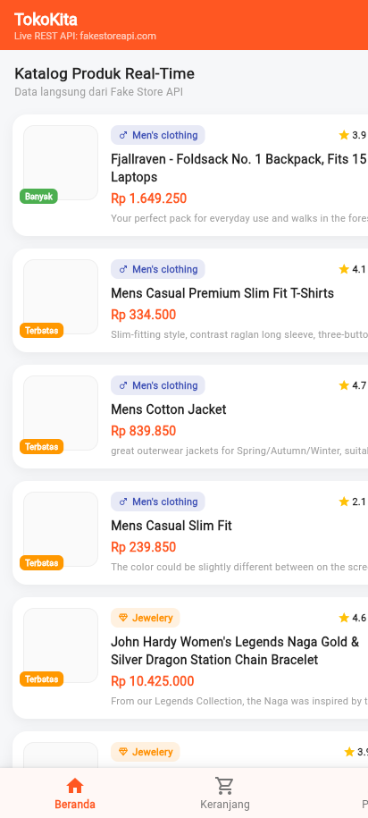
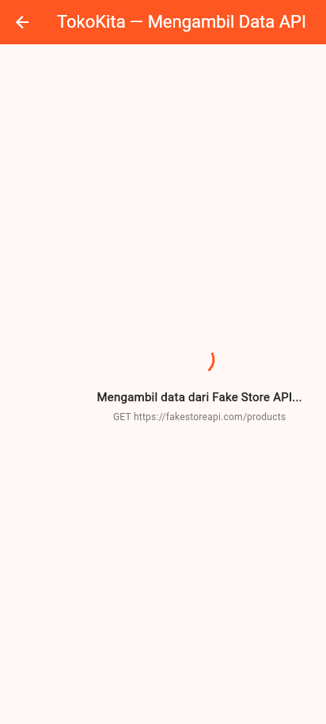
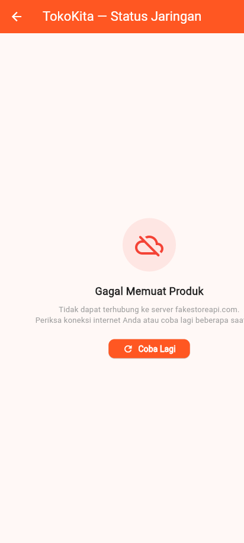
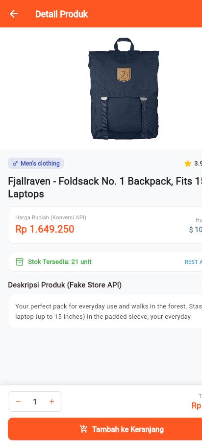
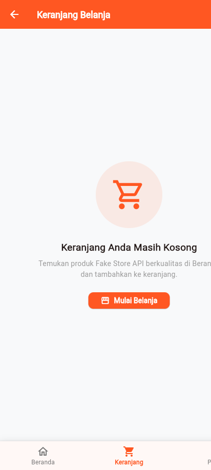
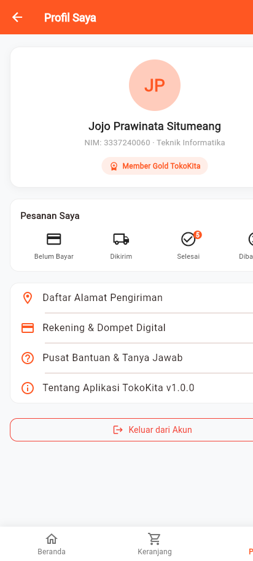

# Tugas 7: HTTP Networking & Konsumsi REST API TokoKita

**Mata Kuliah:** Pemrograman Mobile  
**Pertemuan:** 7 (HTTP Networking & Konsumsi REST API)  
**Mahasiswa:** Jojo Prawinata Situmeang  
**NIM:** 3337240060  
**Program Studi:** Teknik Informatika  

---

## 📌 Ringkasan Proyek

Proyek ini merupakan pembaruan dari aplikasi e-commerce **TokoKita** dengan beralih dari data dummy lokal ke data riil yang diambil langsung dari REST API publik (**Fake Store API** di `https://fakestoreapi.com/products`). Proyek ini mencakup implementasi protokol HTTP asynchronous, deserialisasi JSON dengan *null-safety*, penanganan daur hidup UI menggunakan `FutureBuilder`, strategi mitigasi error jaringan (*friendly error card & retry button*), serta fitur *pull-to-refresh* menggunakan `RefreshIndicator`.

---

## 🚀 Fitur Utama

1. **Konsumsi REST API Asynchronous (`package:http`)**:
   - `fetchProducts()`: Mengambil daftar 20 produk katalog dari `https://fakestoreapi.com/products`.
   - `fetchProductDetail(int id)`: Mengambil data rincian spesifik produk dari `https://fakestoreapi.com/products/{id}`.
2. **Model Deserialisasi & Adaptasi JSON (`Product.fromJson`)**:
   - Pemetaan *field* `id`, `title` -> `nama`, `description` -> `deskripsi`, `category` -> `kategori`, dan `image` -> `gambarUrl`.
   - Konversi mata uang Dollar (USD) ke Rupiah (IDR) otomatis dengan kurs acuan Rp 16.000,-.
   - Ekstraksi *nested map* `rating` (`rate` dan `count`).
   - Kalkulasi diskon promo dinamis & harga coret.
3. **Reaktif UI dengan `FutureBuilder`**:
   - Status Memuat: Menampilkan `CircularProgressIndicator` di tengah layar.
   - Status Berhasil: Menampilkan daftar `ProductCard` dengan *lazy-loading* via `ListView.builder`.
   - Status Gagal: Menampilkan kartu error interaktif yang ramah pengguna.
4. **Mekanisme Error Handling & Tombol Coba Lagi**:
   - Pengecekan eksplisit `response.statusCode == 200` sebelum parsing JSON.
   - Penangkapan `SocketException` dan `ClientException` dengan pesan ramah.
   - Tombol **"Coba Lagi"** yang me-refresh state `_productsFuture` seketika.
5. **Pull-to-Refresh (`RefreshIndicator`)**:
   - Pengguna dapat menarik layar ke bawah (*swipe-down*) untuk meminta data terbaru dari server.
6. **Sinkronisasi Data Detail Terkini (`ProductDetailPage`)**:
   - Mengombinasikan penerimaan instan dari rute (*optimistic UI*) dengan sinkronisasi latar belakang ke endpoint detail.
7. **Pengujian Otomatis Komprehensif (Unit Testing & Widget Testing)**:
   - 8 test cases lulus 100% (`flutter test`).

---

## 📁 Struktur Direktori

```text
Tugas-7/
├── lib/
│   ├── main.dart                      # Inisialisasi aplikasi & konfigurasi rute
│   ├── models/
│   │   └── product.dart               # Model Product, fromJson, toJson, & helper stok
│   ├── screens/
│   │   ├── main_page.dart             # Kerangka BottomNavigationBar & IndexedStack
│   │   ├── home_page.dart             # Katalog produk, FutureBuilder, & RefreshIndicator
│   │   ├── product_detail_page.dart   # Rincian produk & fetchProductDetail sync
│   │   ├── cart_page.dart             # Placeholder keranjang belanja
│   │   └── profile_page.dart          # Placeholder profil mahasiswa
│   ├── services/
│   │   └── product_service.dart       # HTTP client, GET request, error handling
│   └── widgets/
│       ├── category_tag.dart          # Lencana kategori dinamis
│       ├── price_label.dart           # Format harga Rupiah & harga coret
│       └── product_card.dart          # Kartu produk katalog responsif
├── test/
│   ├── product_service_test.dart      # Unit test model & error simulation (5 tests)
│   └── widget_test.dart               # Widget test FutureBuilder, error, & UI (3 tests)
├── screenshots/                       # Bukti eksekusi dan pengujian aplikasi
└── pubspec.yaml                       # Dependensi proyek (http ^1.2.0, flutter)
```

---

## 🧪 Hasil Pengujian Otomatis (`flutter test`)

```text
00:01 +0: Unit Test: Product.fromJson berhasil memetakan JSON Fake Store API
00:01 +1: Unit Test: Product.toJson berhasil men-serialisasi model kembali ke Map JSON
00:01 +2: Unit Test: Product.getStatusStok mengembalikan status yang akurat
00:01 +3: Unit Test: Simulasi Error melempar SocketException dengan pesan informatif
00:01 +4: Unit Test: Simulasi Error pada fetchProductDetail melempar Exception
00:01 +5: Widget Test: FutureBuilder Loading Indicator dan Daftar Produk Ter-render
00:01 +6: Widget Test: FutureBuilder Error State dan Tombol Coba Lagi Berfungsi
00:01 +7: Widget Test: Navigasi Utama Aplikasi TokoKita Pertemuan 7
00:01 +8: All tests passed!
```

---

## 📸 Tangkapan Layar Aplikasi

| Beranda (Live API) | Loading State (`FutureBuilder`) | Error State & Coba Lagi |
|:---:|:---:|:---:|
|  |  |  |

| Detail Produk (`fetchProductDetail`) | Keranjang Belanja | Profil Mahasiswa |
|:---:|:---:|:---:|
|  |  |  |

---

## 📝 Dokumen Laporan Praktikum

Laporan praktikum resmi telah dibuat lengkap dengan format nama file:
- `Praktikum7_3337240060_Jojo Prawinata Situmeang.docx`
- `Praktikum7_3337240060_Jojo Prawinata Situmeang.pdf`
Lokasi berkas: `D:\Academic\Semester 5\Pemrograman Sistem Mobile Ruang Lab\`
