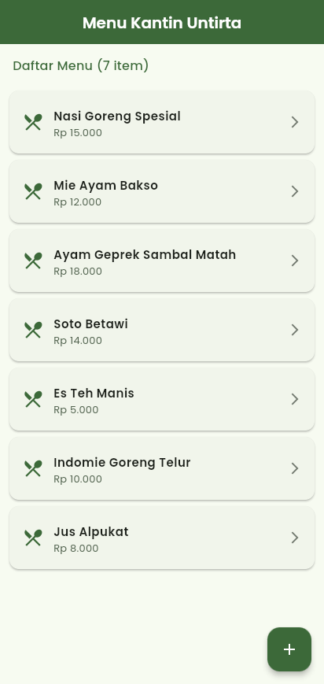
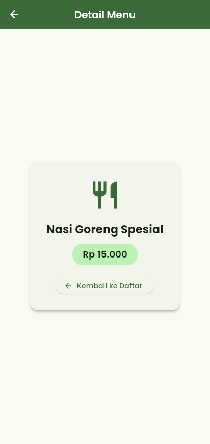
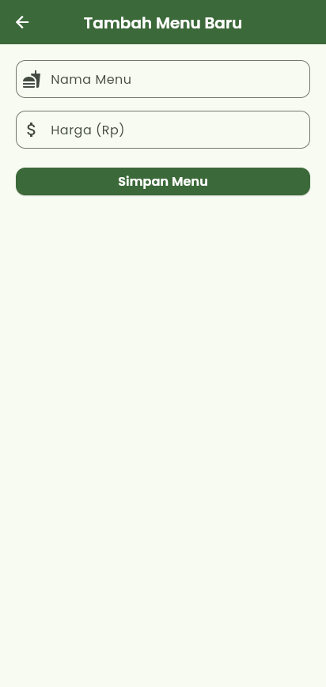
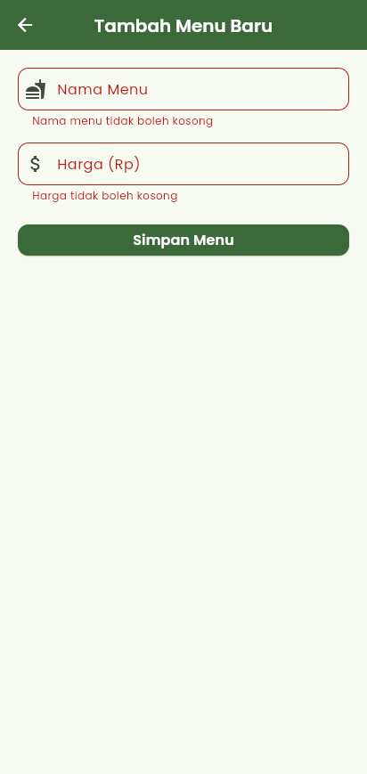
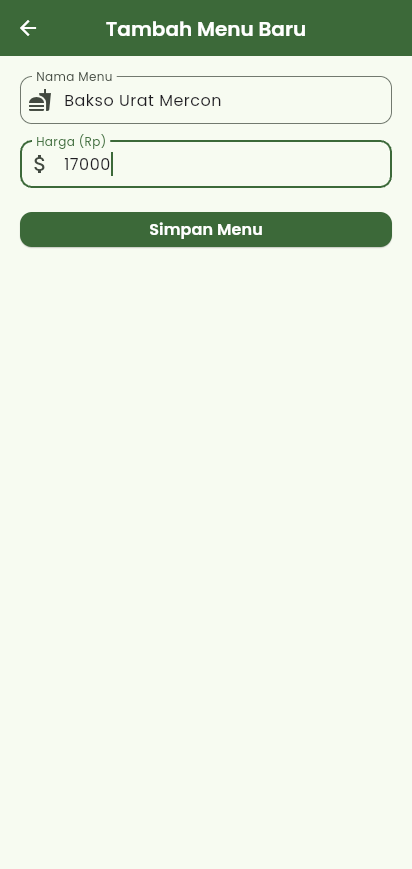
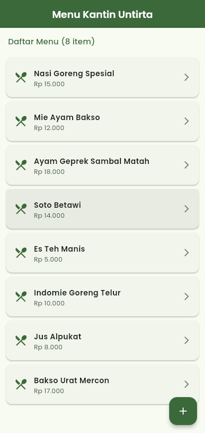

# Tugas 8 — UTS Pemrograman Mobile: Aplikasi Pencatat Menu Kantin

**Mata Kuliah:** Pemrograman Mobile  
**Dosen Pengampu:** Royan Habibie Sukarna  
**Ujian:** UTS Ganjil 2026/2027 (Rabu, 21 Oktober 2026)  
**Mahasiswa:** Jojo Prawinata Situmeang — NIM 3337240060  
**Program Studi:** Teknik Informatika, Universitas Sultan Ageng Tirtayasa

---

## 📌 Ringkasan

Aplikasi **Kantin Untirta** adalah pencatat menu kantin sederhana dengan tiga halaman:

1. **Daftar Menu** (`DaftarMenuPage`, StatefulWidget) — sesuai Gambar 1 soal.
2. **Detail Menu** (`DetailMenuPage`) — menampilkan nama & harga, bisa kembali ke daftar.
3. **Tambah Menu** (`TambahMenuPage`) — form tervalidasi sesuai Gambar 2 soal.

Package: **`get`** (hanya untuk navigasi: `GetMaterialApp`, `Get.to()`, `Get.back()`) dan **`google_fonts`** (font Poppins).

---

## 🌳 Kesesuaian Struktur Widget

### Gambar 1 — Halaman Daftar Menu
```text
Scaffold
├── AppBar
│   └── Text                → KantinText('Menu Kantin Untirta')
├── Column
│   ├── Padding
│   │   └── Text            → KantinText('Daftar Menu (n item)')
│   └── Expanded
│       └── ListView.builder
│           └── Card
│               └── ListTile
│                   ├── Icon (leading)    → Icons.restaurant_menu
│                   ├── Text (title)      → KantinText(nama)
│                   ├── Text (subtitle)   → KantinText(harga)
│                   └── Icon (trailing)   → Icons.arrow_forward_ios
└── FloatingActionButton
    └── Icon                → Icons.add
```

### Gambar 2 — Halaman Tambah Menu
```text
Scaffold
├── AppBar
│   └── Text                → KantinText('Tambah Menu Baru')
└── Padding
    └── Form
        └── Column
            ├── TextFormField   (Nama Menu — wajib diisi)
            ├── SizedBox
            ├── TextFormField   (Harga — wajib, hanya angka, > 0)
            ├── SizedBox
            └── ElevatedButton
                └── Text        → KantinText('Simpan Menu')
```

---

## ✅ Pemenuhan Ketentuan

| Soal | Ketentuan | Implementasi |
|---|---|---|
| 1 (20) | Custom widget teks reusable, ≥ 2 parameter gaya, font google_fonts | [`KantinText`](lib/widgets/kantin_text.dart) — parameter `fontSize`, `fontWeight`, `color`, `textAlign`, `maxLines`, `overflow`; font **Poppins** |
| 1 | Komentar alasan desain 2–3 baris di atas class | Ada tepat di atas `class KantinText` |
| 2 (45) | StatefulWidget, List biasa di State, ≥ 5 data | `_daftarMenu` berisi 7 menu awal |
| 2 | `ListView.builder`, nama di title, harga di subtitle | ✔ |
| 2 | Tap item → detail via `Get.to()` | `Get.to(() => DetailMenuPage(menu: menu))` |
| 2 | FAB → tambah menu via `Get.to()` | `await Get.to(() => const TambahMenuPage())` |
| 3 (35) | Nama & harga tidak boleh kosong | `validator` pada kedua `TextFormField` |
| 3 | Harga hanya angka & divalidasi | `FilteringTextInputFormatter.digitsOnly` + `int.tryParse` (> 0) |
| 3 | Kirim data via `Get.back(result: ...)` | `Get.back(result: menuBaru)` |
| 3 | Daftar menambah ke List + `setState` | `setState(() => _daftarMenu.add(result))` |

---

## 📁 Struktur Direktori

```text
Tugas-8/
├── lib/
│   ├── main.dart                     # GetMaterialApp + tema
│   ├── models/menu_item.dart         # Model MenuItem (nama, harga)
│   ├── widgets/kantin_text.dart      # Custom widget teks (Soal 1)
│   └── screens/
│       ├── daftar_menu_page.dart     # Soal 2 (Gambar 1)
│       ├── detail_menu_page.dart     # Halaman detail
│       └── tambah_menu_page.dart     # Soal 3 (Gambar 2)
├── test/widget_test.dart             # 5 widget test
└── screenshots/
```

---

## 🧪 Pengujian

```text
flutter analyze  → No issues found!
flutter test     → 5/5 All tests passed!
```

---

## 📸 Tangkapan Layar

| Daftar Menu | Detail Menu | Form Tambah |
|:---:|:---:|:---:|
|  |  |  |

| Validasi Form | Form Terisi | Menu Baru Ditambahkan |
|:---:|:---:|:---:|
|  |  |  |

---

## ▶️ Menjalankan

```bash
flutter pub get
flutter run
```
