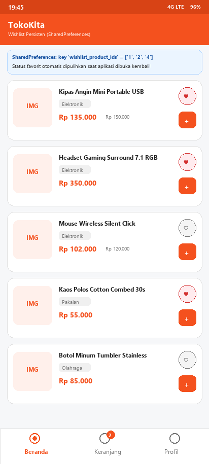
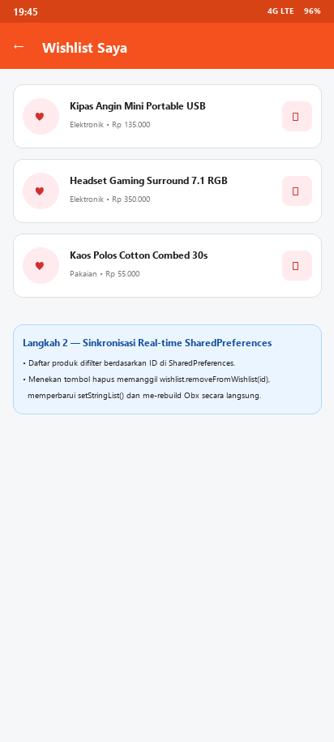
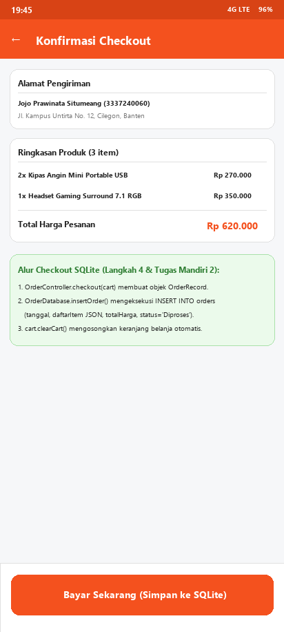
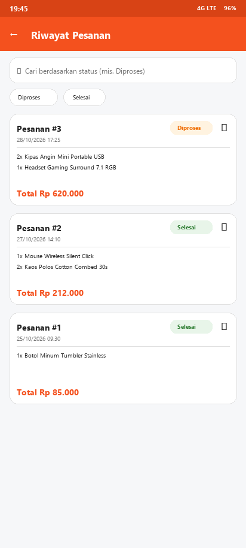
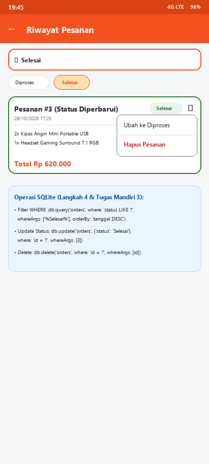

# TokoKita — Tugas Pertemuan 9: Local Storage (SharedPreferences & SQLite)

> **Mata Kuliah:** Pemrograman Sistem Mobile (3 SKS)  
> **Pertemuan:** Pertemuan 9 — Mode Luring (Kelas + Lab)  
> **Topik:** Local Storage (`SharedPreferences`, `SQLite` / `sqflite`)  
> **Studi Kasus:** Project TokoKita — Menyimpan Wishlist & Riwayat Pesanan Secara Lokal  
> **Nama Mahasiswa:** Jojo Prawinata Situmeang  
> **NIM:** 3337240060  
> **Program Studi:** Teknik Informatika  

---

## 📌 Daftar Isi
1. [Deskripsi Proyek](#-deskripsi-proyek)
2. [Arsitektur Penyimpanan Lokal TokoKita](#-arsitektur-penyimpanan-lokal-tokokita)
3. [Struktur Folder & Arsitektur Kode](#-struktur-folder--arsitektur-kode)
4. [Rincian Implementasi Langkah Kerja (1–4)](#-rincian-implementasi-langkah-kerja-14)
5. [Rincian Implementasi & Jawaban Tugas Mandiri (1–5)](#-rincian-implementasi--jawaban-tugas-mandiri-15)
6. [Galeri Screenshot Aplikasi](#-galeri-screenshot-aplikasi)
7. [Pengujian Otomatis (Unit & Widget Test)](#-pengujian-otomatis-unit--widget-test)
8. [Cara Menjalankan Proyek](#-cara-menjalankan-proyek)

---

## 📖 Deskripsi Proyek

Pada pertemuan-pertemuan sebelumnya, aplikasi **TokoKita** menyimpan status favorit (*wishlist*) pada `ProductCard` menggunakan `setState` lokal dan mengosongkan keranjang saat checkout tanpa merekam riwayat transaksi secara permanen. Akibatnya, seluruh tanda favorit dan riwayat pesanan hilang setiap kali aplikasi ditutup atau di-*restart*.

Pada **Pertemuan 9** ini, aplikasi **TokoKita** dilengkapi dengan dua mekanisme penyimpanan lokal (*local persistence*) yang dipilih sesuai karakteristik datanya:
1. **`SharedPreferences` (Key-Value Storage)** untuk menyimpan daftar ID produk favorit (*wishlist*) di bawah kunci `wishlist_product_ids` (`List<String>`).
2. **`SQLite` (`sqflite` Relational Database)** untuk menyimpan, menampilkan, memperbarui status (`Diproses` ↔ `Selesai`), menghapus, serta memfilter riwayat pesanan menggunakan kueri SQL `WHERE status LIKE ?`.

---

## 🗄️ Arsitektur Penyimpanan Lokal TokoKita

```
┌─────────────────────────────────────────────────────────────────────────┐
│                         APLIKASI TOKOKITA (UI)                          │
│  ProductCard  │  WishlistPage  │  CheckoutPage  │   OrderHistoryPage   │
└───────┬───────────────┬────────────────┬────────────────────┬───────────┘
        │               │                │                    │
        ▼               ▼                ▼                    ▼
┌───────────────────────────────┐ ┌───────────────────────────────────────┐
│   WishlistController (GetX)   │ │         OrderController (GetX)        │
│ • favoriteIds (RxSet<int>)    │ │ • orders (RxList<OrderRecord>)        │
│ • loadWishlist()              │ │ • statusQuery (RxString)              │
│ • toggleFavorite(id)          │ │ • checkout(cart) / search(keyword)    │
│ • removeFavorite(id)          │ │ • updateStatus(id, s) / deleteOrder() │
└───────────────┬───────────────┘ └───────────────────┬───────────────────┘
                │                                     │
                ▼                                     ▼
┌───────────────────────────────┐ ┌───────────────────────────────────────┐
│      SharedPreferences        │ │        OrderDatabase (sqflite)        │
│ Key: "wishlist_product_ids"   │ │ File: tokokita_orders.db              │
│ Value: List<String>           │ │ Tabel: orders (id, tanggal,           │
│ Contoh: ["1", "2", "5"]       │ │        daftarItem, totalHarga, status)│
└───────────────────────────────┘ └───────────────────────────────────────┘
```

---

## 📂 Struktur Folder & Arsitektur Kode

```
Tugas-9/
├── lib/
│   ├── controllers/
│   │   ├── cart_controller.dart        # State keranjang belanja (GetX)
│   │   ├── navigation_controller.dart  # Kontrol tab aktif BottomNavigationBar
│   │   ├── wishlist_controller.dart    # State wishlist di atas SharedPreferences
│   │   └── order_controller.dart       # State riwayat pesanan di atas SQLite
│   ├── models/
│   │   ├── product.dart                # Model Product, DiscountedProduct & data katalog
│   │   ├── cart_item.dart              # Model item keranjang
│   │   └── order.dart                  # Model OrderItem, OrderStatus & OrderRecord (toMap/fromMap)
│   ├── services/
│   │   └── order_database.dart         # Helper SQLite: openDatabase, CREATE TABLE, CRUD & WHERE
│   ├── screens/
│   │   ├── main_page.dart              # Root BottomNavigationBar
│   │   ├── home_page.dart              # Katalog produk dengan ikon favorit persisten
│   │   ├── product_detail_page.dart    # Detail produk & tambah ke keranjang
│   │   ├── cart_page.dart              # Halaman keranjang belanja
│   │   ├── checkout_page.dart          # Konfirmasi checkout -> insertOrder SQLite + clearCart
│   │   ├── order_success_page.dart     # Bukti transaksi berhasil
│   │   ├── wishlist_page.dart          # Halaman Wishlist dari SharedPreferences + tombol hapus
│   │   ├── order_history_page.dart     # Halaman Riwayat Pesanan SQLite + Search WHERE + CRUD
│   │   └── profile_page.dart           # Profil mahasiswa + akses cepat Wishlist & Riwayat Pesanan
│   ├── widgets/
│   │   ├── category_tag.dart           # Chip kategori
│   │   ├── price_label.dart            # Format harga Rupiah
│   │   └── product_card.dart           # Kartu produk terhubung ke WishlistController (SharedPreferences)
│   └── main.dart                       # Entry point GetMaterialApp & GlobalBindings
├── test/
│   ├── storage_test.dart               # 5 unit test SharedPreferences & SQLite CRUD + WHERE
│   └── widget_test.dart                # Widget test alur penuh wishlist & checkout ke SQLite
├── screenshots/                        # 5 screenshot hasil pengujian praktikum
└── pubspec.yaml                        # Dependensi: get, shared_preferences, sqflite, path
```

---

## 🛠️ Rincian Implementasi Langkah Kerja (1–4)

### Langkah 1 — SharedPreferences: Menyimpan Wishlist
- Menambahkan paket `shared_preferences` pada `pubspec.yaml`.
- Membuat `WishlistController` (`lib/controllers/wishlist_controller.dart`) yang menyimpan himpunan ID produk favorit ke `SharedPreferences` menggunakan `prefs.setStringList('wishlist_product_ids', ...)` dan memuatnya kembali saat inisialisasi dengan `prefs.getStringList('wishlist_product_ids')`.
- Memperbarui `ProductCard` (`lib/widgets/product_card.dart`) agar tidak lagi memakai `setState` lokal, melainkan membaca `wishlist.isFavorite(product.id)` di dalam `Obx` dan memanggil `wishlist.toggleFavorite(product.id)` saat ikon hati ditekan.

### Langkah 2 — Halaman Wishlist
- Membuat `WishlistPage` (`lib/screens/wishlist_page.dart`) yang menampilkan seluruh objek `Product` dari `daftarProduk` yang ID-nya tercatat di `WishlistController.favoriteIds`.
- Menyediakan tombol hapus (`Icons.delete_outline`) pada setiap item wishlist yang memanggil `wishlist.removeFavorite(product.id)` untuk memperbarui `SharedPreferences` sekaligus memperbarui tampilan secara instan.
- Menambahkan menu navigasi **"Wishlist Saya"** beserta badge jumlah item favorit pada `ProfilePage` (`lib/screens/profile_page.dart`).

### Langkah 3 — Setup SQLite untuk Riwayat Pesanan
- Menambahkan paket `sqflite` dan `path` pada `pubspec.yaml`.
- Membuat model `OrderRecord` & `OrderItem` (`lib/models/order.dart`) dengan konversi `toMap()` dan `fromMap()` serta serialisasi JSON untuk kolom `daftarItem`.
- Membuat helper database `OrderDatabase` (`lib/services/order_database.dart`) yang menginisialisasi file `tokokita_orders.db` dan mengeksekusi DDL pada callback `onCreate`:
  ```sql
  CREATE TABLE orders (
    id INTEGER PRIMARY KEY AUTOINCREMENT,
    tanggal TEXT NOT NULL,
    daftarItem TEXT NOT NULL,
    totalHarga REAL NOT NULL,
    status TEXT NOT NULL
  )
  ```

### Langkah 4 — Operasi CRUD Riwayat Pesanan dengan sqflite
- **Create (`insertOrder`)**: Dipanggil saat pengguna menekan tombol **Bayar Sekarang** di `CheckoutPage` melalui `OrderController.checkout(cartController)`.
- **Read (`getAllOrders`)**: Mengambil seluruh baris dari tabel `orders` dengan urutan `tanggal DESC, id DESC` dan menampilkannya pada `OrderHistoryPage` menggunakan `ListView.builder`.
- **Update (`updateOrderStatus`)**: Mengubah kolom `status` pesanan dari `'Diproses'` menjadi `'Selesai'` (atau sebaliknya) melalui `PopupMenuButton` pada tiap kartu pesanan (`WHERE id = ?`).
- **Delete (`deleteOrder`)**: Menghapus satu baris pesanan dari tabel `orders` berdasarkan `id` (`WHERE id = ?`).

---

## 🎯 Rincian Implementasi & Jawaban Tugas Mandiri (1–5)

### Tugas Mandiri 1 — Persistensi Status Favorit pada `ProductCard`
Status favorit pada `ProductCard` telah dihubungkan penuh ke `SharedPreferences` melalui `WishlistController`. Saat aplikasi ditutup dan dibuka kembali, `onInit()` pada `WishlistController` memanggil `loadWishlist()` yang membaca `SharedPreferences.getStringList('wishlist_product_ids')`, sehingga ikon hati merah tetap menyala pada produk yang telah ditandai sebelumnya.

### Tugas Mandiri 2 — Alur Checkout Lengkap (Simpan ke SQLite & Kosongkan Keranjang)
Pada `CheckoutPage._processPayment()` (`lib/screens/checkout_page.dart`), menekan tombol **Bayar Sekarang** mengeksekusi `await Get.find<OrderController>().checkout(_cartController)`. Method ini menyusun objek `OrderRecord` dari isi keranjang aktif, menyimpannya ke tabel `orders` di SQLite via `db.insertOrder(order)`, memanggil `cart.clearCart()`, memuat ulang daftar riwayat pesanan, lalu mengarahkan pengguna ke `OrderSuccessPage`.

### Tugas Mandiri 3 — Fitur Pencarian Riwayat Pesanan dengan Klausa SQL `WHERE`
Pada `OrderDatabase.searchOrdersByStatus(String keyword)` (`lib/services/order_database.dart`), pencarian diimplementasikan langsung di tingkat SQL menggunakan klausa `WHERE` dan parameter terikat (`whereArgs`) untuk mencegah SQL Injection:
```dart
Future<List<OrderRecord>> searchOrdersByStatus(String keyword) async {
  final db = await database;
  final rows = await db.query(
    table,
    where: 'status LIKE ?',
    whereArgs: ['%${keyword.trim()}%'],
    orderBy: 'tanggal DESC, id DESC',
  );
  return rows.map(OrderRecord.fromMap).toList();
}
```
Pada `OrderHistoryPage`, pengguna dapat mengetik kata kunci status pada kolom pencarian atau menekan `ChoiceChip` (`Semua`, `Diproses`, `Selesai`) untuk memfilter riwayat pesanan secara langsung.

### Tugas Mandiri 4 — Analisis Pemilihan `SharedPreferences` untuk Wishlist vs `SQLite` untuk Riwayat Pesanan

| Dimensi Analisis | Wishlist Produk (`SharedPreferences`) | Riwayat Pesanan (`SQLite` / `sqflite`) |
| :--- | :--- | :--- |
| **Struktur Data** | Sangat sederhana, hanya berupa himpunan/daftar ID produk bertipe primitif (`List<String>`, misalnya `["1", "2", "5"]`) tanpa atribut bersarang. | Terstruktur dan relasional/tabular, memiliki banyak kolom bertipe spesifik (`id INTEGER`, `tanggal TEXT`, `daftarItem TEXT`, `totalHarga REAL`, `status TEXT`). |
| **Volume & Pertumbuhan Data** | Terbatas (*bounded*) pada jumlah produk di katalog yang disukai pengguna (umumnya puluhan ID, ukuran hanya beberapa ratus byte). | Terus bertambah (*unbounded/append-only*) setiap kali pengguna melakukan transaksi checkout dari waktu ke waktu. |
| **Pola Akses & Operasi** | Hanya membutuhkan pembacaan seluruh daftar ID saat startup (`getStringList`) dan penulisan ulang daftar ID saat toggle/hapus (`setStringList`). | Membutuhkan operasi CRUD per baris (`INSERT`, `SELECT`, `UPDATE WHERE id = ?`, `DELETE WHERE id = ?`), pengurutan (`ORDER BY tanggal DESC`), dan pemfilteran (`WHERE status LIKE ?`). |
| **Overhead Teknis** | Sangat ringan (*zero schema overhead*), langsung disimpan sebagai pasangan *key-value* oleh OS (XML `SharedPreferences` di Android / `NSUserDefaults` di iOS). | Menyediakan mesin kueri SQL penuh, indeks kunci utama (`PRIMARY KEY AUTOINCREMENT`), dan jaminan transaksi ACID di atas file `.db`. |

### Tugas Mandiri 5 — Risiko Menyimpan Seluruh Riwayat Pesanan di `SharedPreferences`
Jika seluruh data riwayat pesanan yang terstruktur dan terus bertambah dipaksakan masuk ke dalam `SharedPreferences` (misalnya dengan melakukan serialisasi seluruh daftar pesanan menjadi satu string JSON raksasa), akan muncul risiko-risiko serius berikut:
1. **Degradasi Performa I/O & Memori (*Full Read-Modify-Write Penalty*)**: `SharedPreferences` tidak mendukung pembaruan sebagian (*partial update*). Untuk menambah 1 pesanan baru atau mengubah status 1 pesanan saja, aplikasi harus memuat seluruh riwayat pesanan ke RAM, men-decode seluruh JSON, memodifikasi satu objek, meng-encode ulang seluruh daftar, dan menulis ulang keseluruhan file ke disk. Semakin banyak pesanan, operasi ini menjadi semakin lambat ($O(N)$) dan berisiko menyebabkan *UI freeze* (*jank*) atau *Out-Of-Memory (OOM)*.
2. **Tidak Ada Kemampuan Query, Indexing, dan Filtering di Tingkat Storage**: `SharedPreferences` tidak mengenal klausa `WHERE`, `ORDER BY`, maupun `LIMIT`. Untuk mencari pesanan berstatus `'Selesai'`, seluruh data harus ditarik ke memori aplikasi dan difilter secara manual di sisi Dart.
3. **Risiko Korupsi Data & Ketiadaan Transaksi ACID**: `SharedPreferences` tidak dirancang sebagai database transaksional untuk payload besar. Jika aplikasi berhenti mendadak (*crash* atau kehabisan baterai) saat sedang menulis ulang string JSON besar, seluruh riwayat pesanan dapat rusak atau hilang sekaligus.
4. **Keterbatasan Kapasitas Cache Memori**: `SharedPreferences` menyimpan cache seluruh pasangan *key-value* di memori utama sejak inisialisasi. Menyimpan ribuan riwayat transaksi di dalamnya akan membebani konsumsi RAM aplikasi secara permanen selama aplikasi berjalan.

---

## 📸 Galeri Screenshot Aplikasi

| 01. Wishlist SharedPreferences | 02. Halaman Wishlist & Hapus | 03. Checkout Insert SQLite |
| :---: | :---: | :---: |
|  |  |  |

| 04. Riwayat Pesanan SQLite | 05. Update Status, Delete & Search WHERE |
| :---: | :---: |
|  |  |

---

## 🧪 Pengujian Otomatis (Unit & Widget Test)

Proyek dilengkapi dengan pengujian otomatis pada `test/storage_test.dart` dan `test/widget_test.dart` menggunakan mock `SharedPreferences` dan `sqflite_common_ffi` (*in-memory SQLite*):

```bash
flutter test
flutter analyze
```

---

## 💻 Cara Menjalankan Proyek

```bash
cd Tugas-9
flutter pub get
flutter test
flutter run
```

---
*Dibuat untuk memenuhi Tugas Praktikum Pertemuan 9 — Laboratorium Pemrograman Sistem Mobile.*
